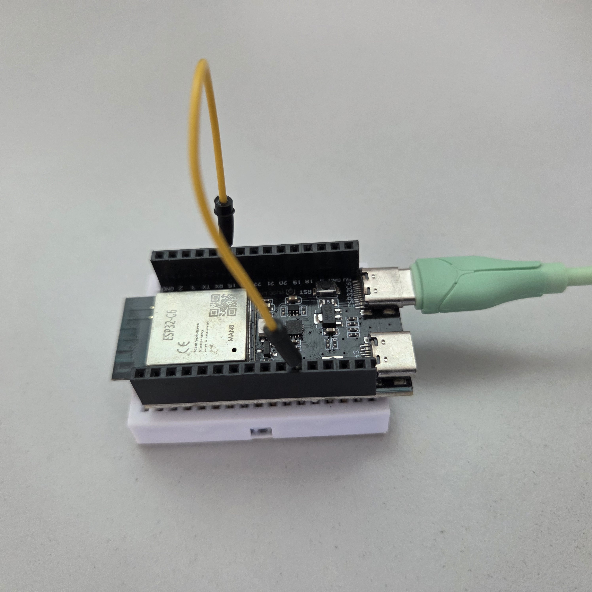
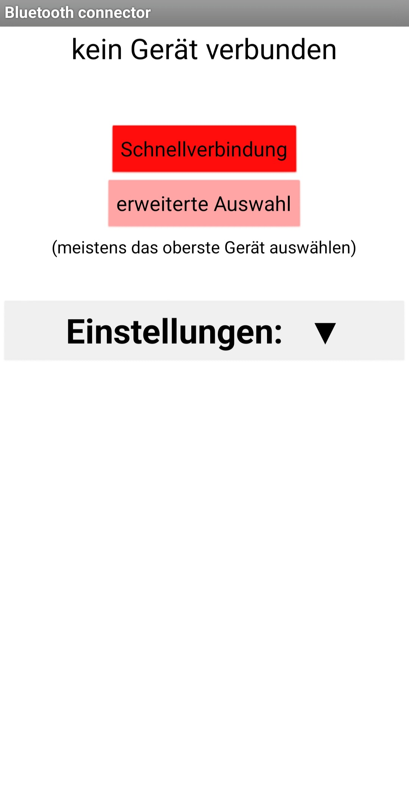
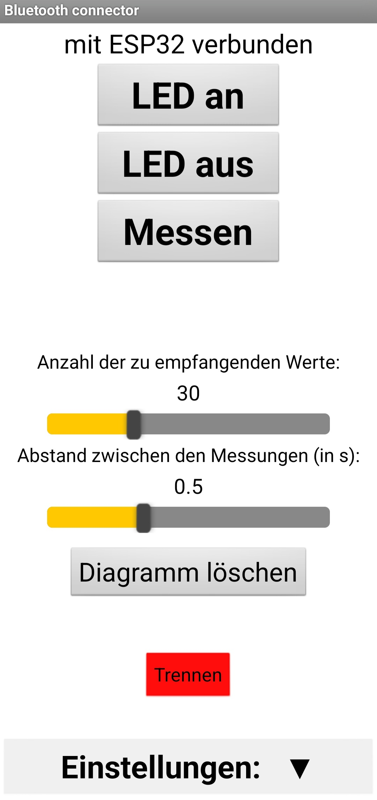
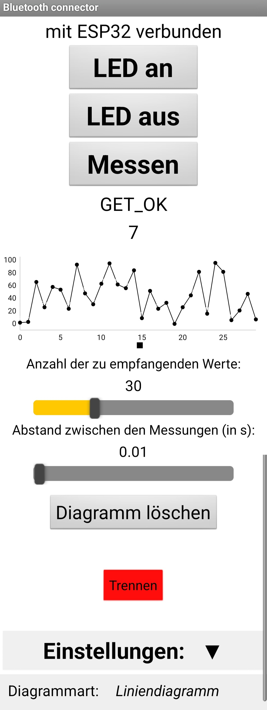

---
---
<link rel="stylesheet" href="{{ '/style.css' | relative_url }}">

# ESP32 Connect

## Dein ESP32. Dein Smartphone. Deine Verbindung.

**ESP32 Connect** verbindet deinen ESP32 mit deinem Android-Smartphone. Über Bluetooth Low Energy (BLE) kannst du deinen Mikrocontroller kabellos steuern, Befehle senden und Daten empfangen.

---

## Was ESP32 Connect kann

- **Kabellos verbinden:** Kommunikation zwischen Smartphone und ESP32 über Bluetooth Low Energy.
- **Direkt steuern:** Befehle bequem über die Android-App senden.
- **Hardware bedienen:** Angeschlossene Komponenten wie LEDs ein- und ausschalten.
- **Daten empfangen:** Informationen vom ESP32 direkt auf dem Smartphone anzeigen.
- **Daten visualisieren:** Empfangene Werte in einem Diagramm darstellen.
- **Flexibel erweitern:** Eine Grundlage für eigene ESP32-Projekte und Anwendungen.

---

## Die App in Aktion

### Verbindung herstellen

Die App ermöglicht es, nach einem ESP32 zu suchen und eine Verbindung herzustellen. Der aktuelle Verbindungsstatus ist jederzeit sichtbar.

*Die App im nicht verbundenen Zustand.*

*Die App nach erfolgreicher Verbindung mit einem ESP32.*

### Daten visualisieren

Neben der Steuerung kann ESP32 Connect auch Daten vom Mikrocontroller empfangen und grafisch darstellen. So lassen sich übertragene Werte direkt auf dem Smartphone verfolgen.

*Empfangene Daten werden in einem Diagramm dargestellt.*

---

## Zwei Komponenten. Ein System.

**Android-App**

Die App ist die Benutzeroberfläche für die Bedienung und Kommunikation mit dem ESP32.

**MicroPython-Programm**

Das Python-Programm wird auf dem ESP32 ausgeführt. Es übernimmt die Kommunikation mit der App und verarbeitet die eingehenden Befehle.

---

## So funktioniert es

1. Das MicroPython-Programm wird auf dem ESP32 eingerichtet.
2. Die Android-App wird auf dem Smartphone installiert.
3. Smartphone und ESP32 verbinden sich über Bluetooth Low Energy.
4. Über die App können Befehle gesendet und Daten empfangen werden.
5. Empfangene Daten lassen sich in der App visualisieren.

---

## ESP32 Connect ausprobieren

Die beiden benötigten Dateien stehen hier zum Download bereit:

- [Android-App – esp32_connect.apk](ressourcen/esp32_connect.apk)
- [MicroPython-Programm – esp32_connect.py](ressourcen/esp32_connect.py)

**ESP32 Connect – mobile Kontrolle und Datenvisualisierung für deinen ESP32.**
